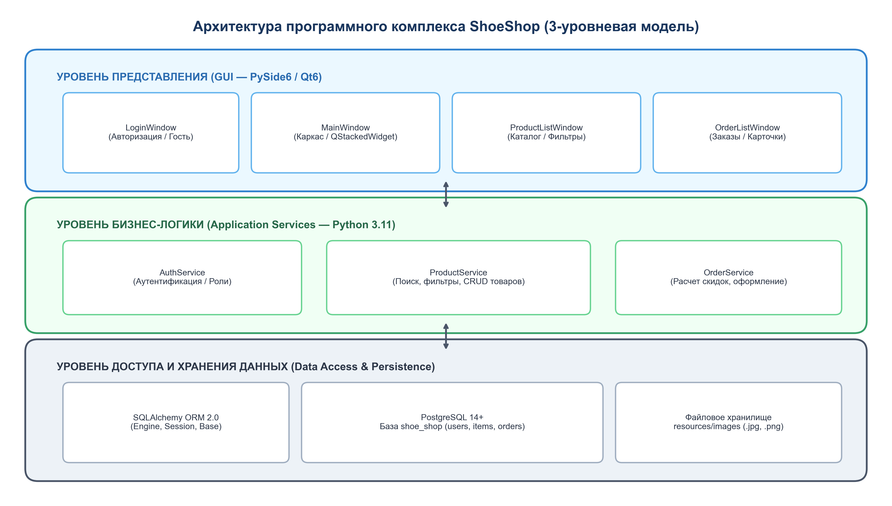
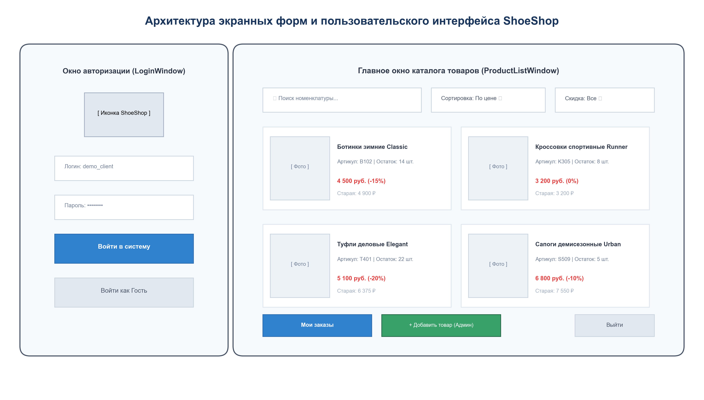
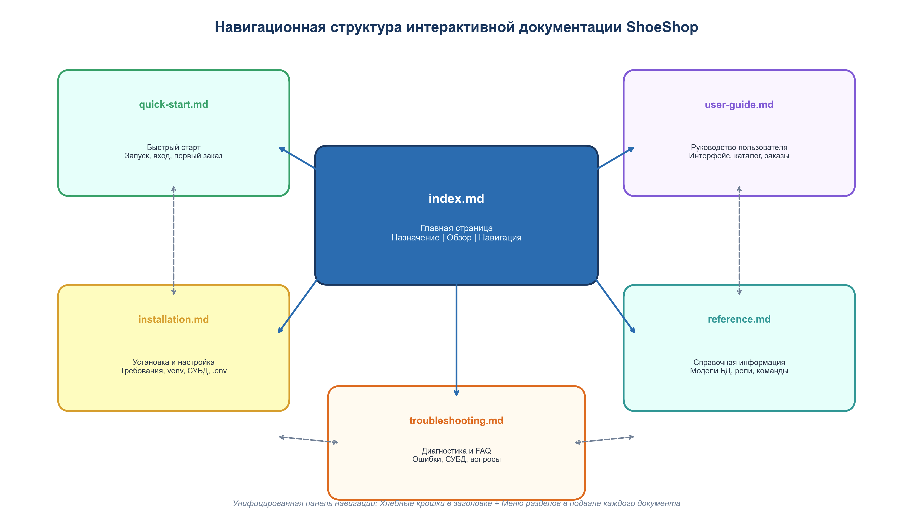
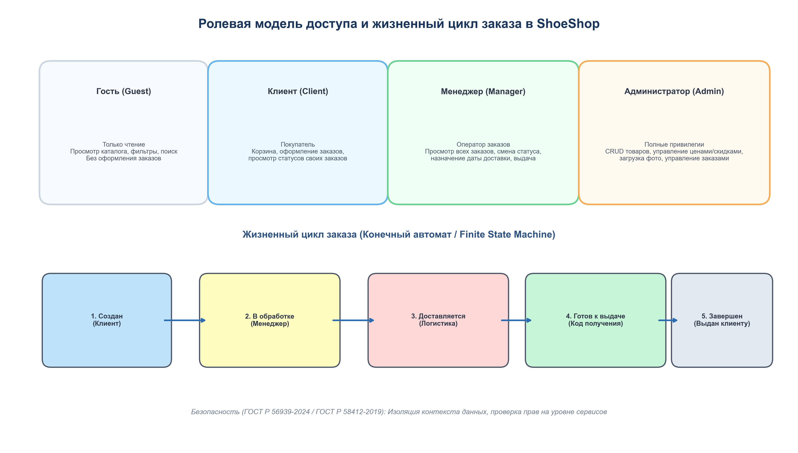

# Документация программного комплекса «ShoeShop»

  

---

## 📌 Навигационное меню

[Главная](index.md) | [Быстрый старт](quick-start.md) | [Установка](installation.md) | [Руководство пользователя](user-guide.md) | [Справочник](reference.md) | [Диагностика и FAQ](troubleshooting.md) | [Регламент обновления](update_regulations.md)

---

## 1. Назначение программного комплекса

**«ShoeShop»** («Магазин обуви») — современный специализированный настольный программный комплекс, предназначенный для комплексной автоматизации торговых, складских и учетных процессов специализированного магазина розничной и мелкооптовой торговли обувью.

> [!NOTE]
> Комплекс спроектирован с учетом стандартов безопасной разработки ПО (ГОСТ Р 56939-2024, ГОСТ Р 58412-2019) и стадий создания автоматизированных систем по ГОСТ 34.601-90. В качестве графической платформы используется **PySide6 (Qt 6)**, в качестве слоя персистентности — СУБД **PostgreSQL 14+** с объектно-реляционным отображением **SQLAlchemy 2.0**.

---

## 2. Ключевые функциональные возможности

- **Многоролевая модель взаимодействия:**
  - *Гостевой режим:* свободный ознакомительный просмотр номенклатуры каталога без необходимости авторизации;
  - *Роль «Клиент»:* просмотр каталога с отображением индивидуальных скидок, подбор позиций, оформление заказов и отслеживание их статуса;
  - *Роль «Менеджер»:* контроль всех оформленных заказов покупателей, изменение этапов выполнения, планирование дат доставки, выдача товара по проверочному коду;
  - *Роль «Администратор»:* полнофункциональное администрирование товарной номенклатуры (добавление, редактирование параметров, цен, скидок, категорий, описаний и прикрепление изображений), управление заказами.
- **Интеллектуальный поиск и фильтрация:**
  - Мгновенный контекстный поиск по наименованию, артикулу, бренду и текстовому описанию;
  - Фильтрация по поставщикам и диапазонам скидок (до 10%, 10–15%, свыше 15%);
  - Сортировка по стоимости товара (по возрастанию / по убыванию) с динамическим расчетом конечной цены с учетом скидки.
- **Автоматизация обработки заказов:**
  - Генерация уникального цифрового проверочного кода получения;
  - Расчет ориентировочной даты доставки заказа в выбранный пункт выдачи;
  - Фиксация статусов в базе данных: *Новый* → *В обработке* → *Доставляется* → *Готов к выдаче* → *Завершен*.
- **Отказоустойчивость и безопасность:**
  - Изоляция параметров подключения и учетных записей в конфигурационном файле `.env`;
  - Пул постоянных соединений с СУБД и автоматическая обработка обрывов связи;
  - Контроль целостности ссылок и валидация вводимых данных на уровне бизнес-логики и схемы БД.

---

## 3. Архитектура программного комплекса

Программный комплекс ShoeShop построен по классической трехзвенной модульной архитектуре, гарантирующей слабую связность компонентов и надежность сопровождения (рисунок 1).

  
*Рисунок 1 — Трехуровневая архитектурная схема комплекса «ShoeShop»*

### Описание архитектурных уровней:
1. **Уровень представления (Presentation Layer):**
   - Главный контроллер приложения `ApplicationController` (`main.py`) управляет жизненным циклом окон.
   - Окно авторизации `LoginWindow` (`views/login_window.py`) реализует безопасную аутентификацию.
   - Главное рабочее пространство `MainWindow` (`views/main_window.py`) содержит контейнер `QStackedWidget` с экранами каталога (`ProductListWindow`), заказов (`OrderListWindow`) и редактирования (`ProductEditWindow`, `OrderEditWindow`).
2. **Уровень сервисов бизнес-логики (Service Layer):**
   - `AuthService` — идентификация пользователей, проверка хешей паролей, распределение прав ролей;
   - `ProductService` — фильтрация ассортимента, расчет цен со скидками, проверка наличия на складе, валидация при сохранении;
   - `OrderService` — формирование корзины, расчет суммы заказа, выбор пункта выдачи, изменение статусов.
3. **Уровень доступа к данным и хранения (Data Access & Persistence Layer):**
   - Декларативные модели SQLAlchemy (`models.py`): сущности `User`, `Product` (`items`), `Order`, `OrderItem`, `PickupPoint`;
   - Модуль инициализации БД (`database.py`): управление пулом соединений к PostgreSQL;
   - Локальное хранилище медиафайлов `resources/images/`: каталожные фотографии товаров.

---

## 4. Пользовательский интерфейс системы

Экранные формы приложения спроектированы в строгом эргономичном стиле с акцентом на скорость работы оператора и интуитивность навигации (рисунок 2).

  
*Рисунок 2 — Схема компоновки экранных форм авторизации и каталога продукции*

---

## 5. Карта интерактивной документации

Для быстрого перехода к интересующему разделу воспользуйтесь ссылками ниже:

| Раздел | Целевая аудитория | Основное назначение | Ссылка |
|---|---|---|---|
| **Быстрый старт** | Все пользователи | Первый запуск, демонстрационные аккаунты, оформление заказа за 2 минуты | [Открыть раздел →](quick-start.md) |
| **Установка и настройка** | Системные администраторы, инженеры | Системные требования, СУБД PostgreSQL, Python-окружение, конфигурация `.env` | [Открыть раздел →](installation.md) |
| **Руководство пользователя** | Покупатели, менеджеры, администраторы | Подробные инструкции по работе с каталогом, заказами и карточками товаров | [Открыть раздел →](user-guide.md) |
| **Справочная информация** | Разработчики, администраторы БД | Схема базы данных, описание полей, матрица ролей, горячие клавиши | [Открыть раздел →](reference.md) |
| **Диагностика и FAQ** | Специалисты технической поддержки | Решение проблем с подключением, исправление ошибок библиотек, ответы на вопросы | [Открыть раздел →](troubleshooting.md) |
| **Регламент обновления** | Инженеры внедрения, сисадмины, ИБ | Регламент выпуска, SemVer, окна обслуживания, миграции БД, откат (Rollback), RACI | [Открыть раздел →](update_regulations.md) |

---

## 6. Навигационный граф документации

Все документы интерактивной системы связаны взаимными перекрестными гиперссылками (рисунок 3).

  
*Рисунок 3 — Навигационный граф интерактивной документации ShoeShop*

---

## 7. Ролевая модель и жизненный цикл заказа

Доступ к операциям в комплексе разграничен в строгом соответствии с ролью учетной записи пользователя (рисунок 4).

  
*Рисунок 4 — Матрица прав доступа и этапы жизненного цикла заказа*

---

[← К началу страницы](#документация-программного-комплекса-shoeshop) | [Перейти к Быстрому старту →](quick-start.md)
